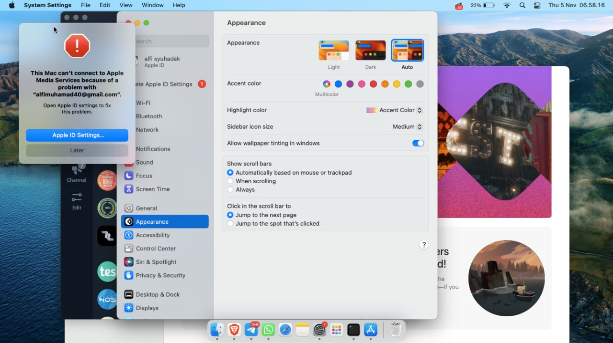
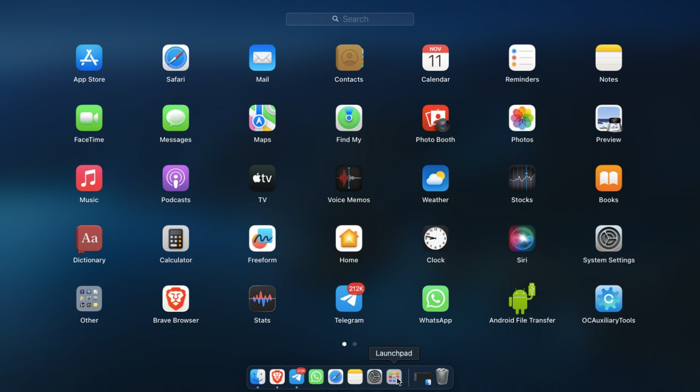
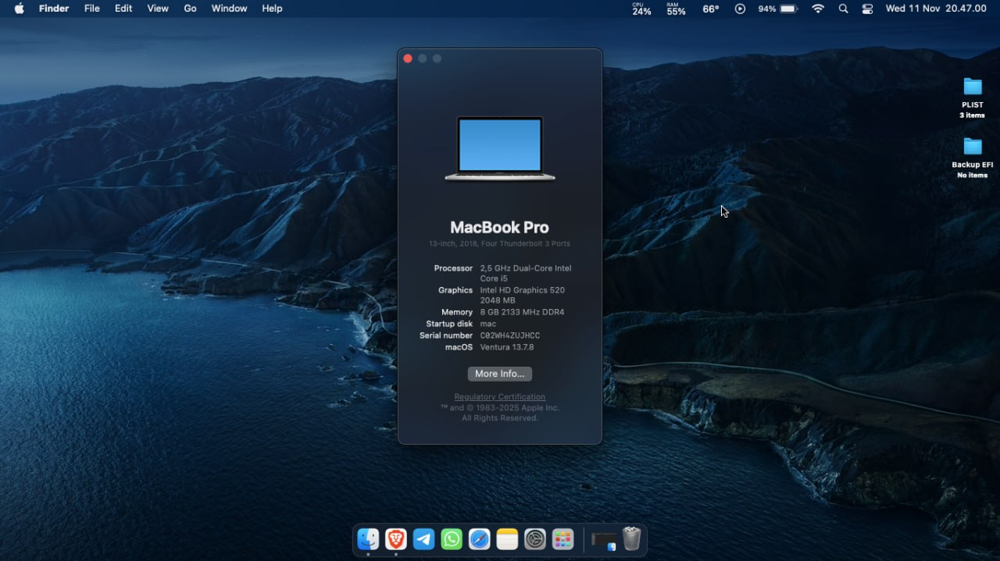
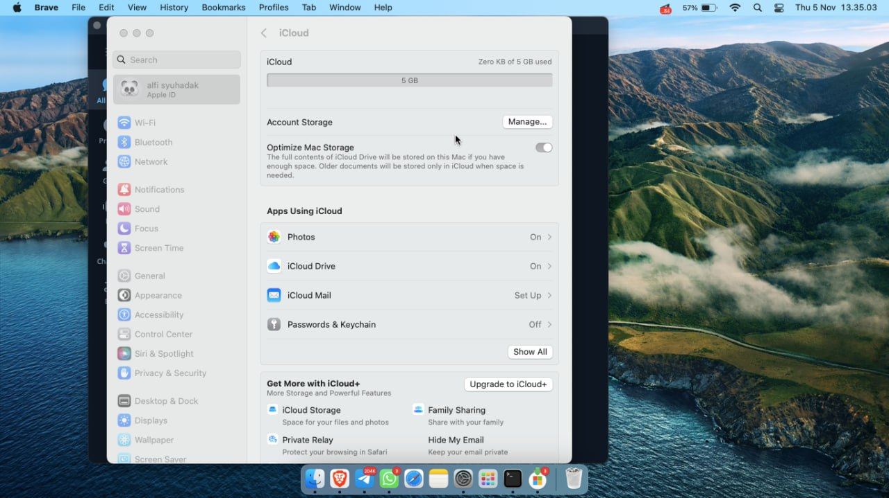
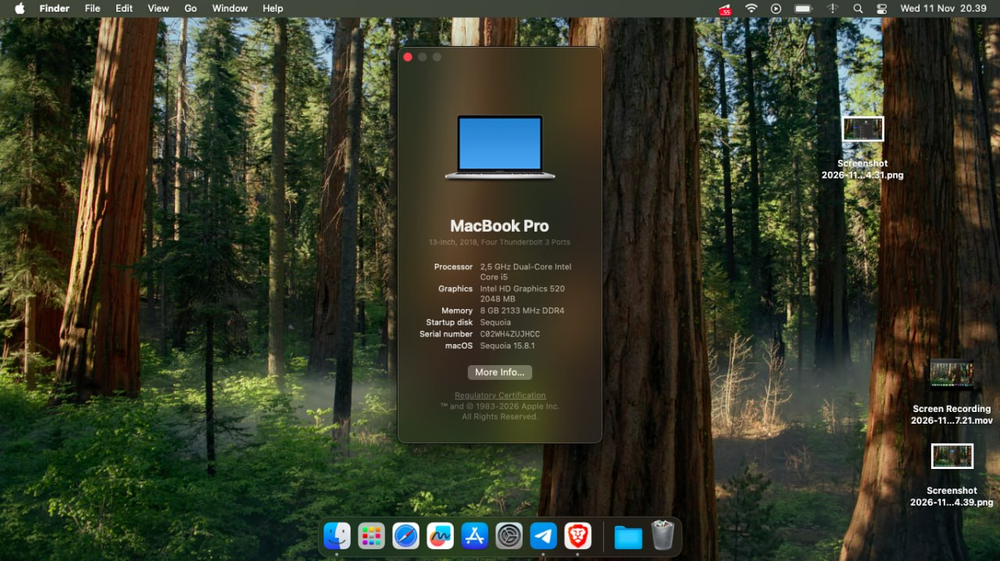
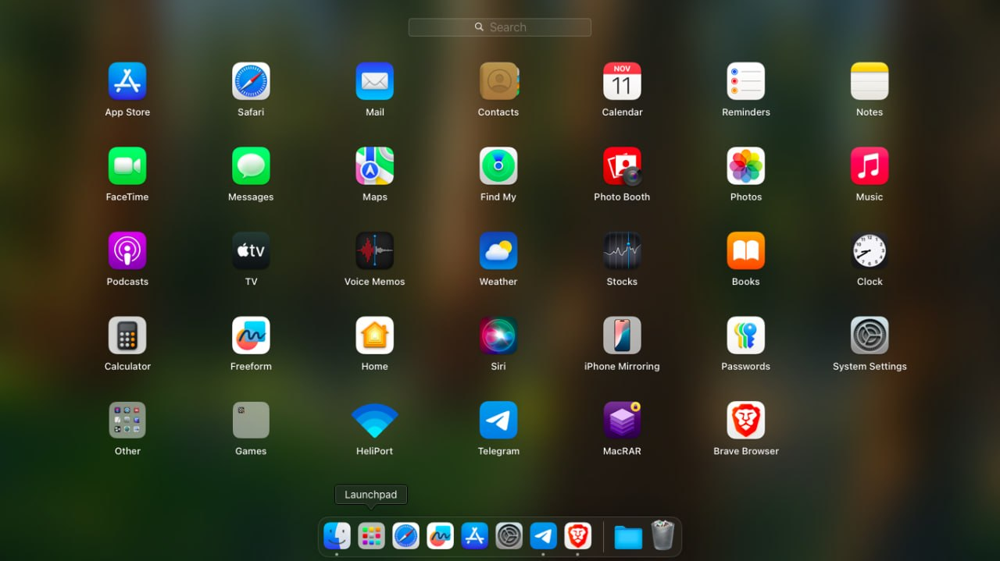
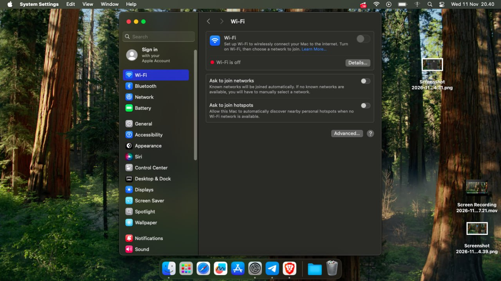
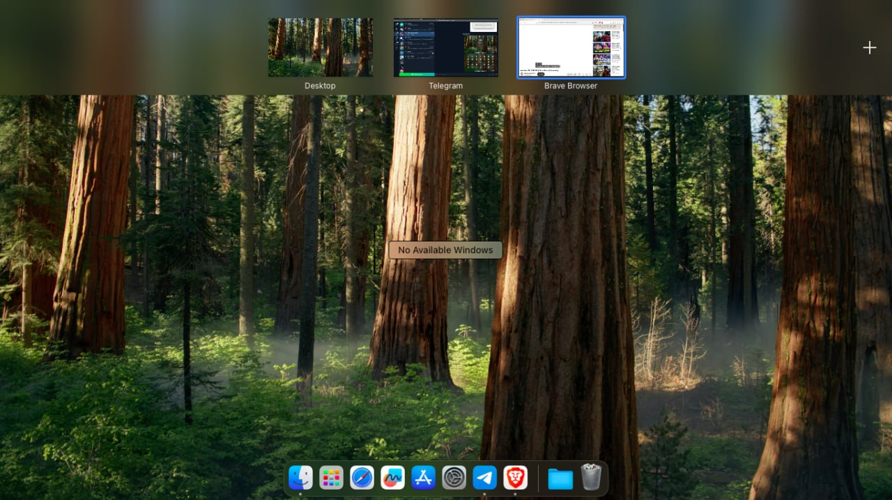

<div align="center">

# ThinkPad X260 · Ventura & Sequoia

EFI OpenCore untuk ThinkPad X260 (Skylake). Satu folder EFI, dipakai untuk dua versi macOS.


</div>

---

## Apa ini?

Ini EFI OpenCore yang saya pakai di ThinkPad X260 untuk menjalankan **macOS Ventura 13** dan **macOS Sequoia 15**. Kext Ventura dan Sequoia dipisah lewat `MinKernel` / `MaxKernel`, jadi tidak perlu ganti `config.plist` tiap mau pindah sistem.

Yang sudah jalan: grafis, audio, keyboard, trackpad, baterai + limit cas baterai, brightness, USB, Ethernet, sleep/wake, card reader, dan Bluetooth. Yang belum: **WiFi di Sequoia** yang harus lewat HeliPort, serta AirDrop/Continuity karena keterbatasan kartu Intel.

## Spek

| Komponen | Detail |
|---|---|
| Laptop | Lenovo ThinkPad X260 |
| CPU | Intel Core i5-6300U, 2C/4T, 2.4–3.0 GHz (Skylake-U) |
| iGPU | Intel HD Graphics 520 |
| RAM | 8/16 GB DDR4-2133 SODIMM (single slot) |
| Storage | SSD SATA 2.5" / NVMe M.2 (tergantung unit) |
| Layar | 12.5" IPS FHD 1920×1080 (ada varian HD 1366×768) |
| WiFi | Intel Dual Band Wireless-AC 8260 |
| Ethernet | Intel I219-LM |
| Audio | Realtek ALC3245, layout-id 11 |
| Card reader | Realtek RTS522A |
| Kamera | HD 720p |
| Port | 3× USB 3.0, HDMI, mini DisplayPort, RJ45, audio 3.5 mm, SD |
| Baterai | Internal + external (47/68 Wh) |
| SMBIOS | MacBookPro15,2 |
| Bootloader | OpenCore 1.0.8 |

Beberapa unit X260 keluar dengan i3-6100U atau i7-6600U. EFI-nya tetap sama, yang beda cuma hasil benchmark. :)

## Status

| Fitur | Ventura 13 | Sequoia 15 | Catatan |
|---|:---:|:---:|---|
| Grafis / QE-CI | ✅ | ✅ | HD 520, framebuffer patch |
| Audio | ✅ | ✅ | AppleALC, layout-id 11 |
| Keyboard | ✅ | ✅ | VoodooPS2 |
| Trackpad | ✅ | ✅ | VoodooRMI + VoodooSMBus |
| Baterai | ✅ | ✅ | SMCBatteryManager + ECEnabler |
| Limit cas baterai | ✅ | ✅ | YogaSMC + SSDT-THINK; ikon petir berubah jadi colokan saat limit tercapai |
| Brightness | ✅ | ✅ | AppleBacklightSmoother + BrightnessKeys |
| Sleep / Wake | ✅ | ✅ | HibernationFixup + RTCMemoryFixup |
| USB | ✅ | ✅ | USBMap |
| Ethernet | ✅ | ✅ | IntelMausi |
| SD Card | ✅ | ✅ | RealtekCardReader |
| Webcam | ✅ | ✅ | USB |
| WiFi | ✅ Native | ⚠️ HeliPort | Lihat bagian WiFi |
| Bluetooth | ✅ | ✅ | Intel 8260 (8087:0A2B), bisa scan + connect |
| Fingerprint | ❌ | ❌ | Tidak ada driver |
| AirDrop / Continuity | ❌ | ❌ | Keterbatasan WiFi Intel |

## WiFi

**Ventura** — pakai `AirportItlwm-Ventura.kext`. WiFi langsung muncul di menu bar dan connect seperti Mac asli. Tidak perlu aplikasi tambahan.

**Sequoia** — pakai `itlwm-Sequoia.kext` + [HeliPort](https://github.com/OpenIntelWireless/HeliPort). WiFi **tidak akan muncul di menu bar**; scan dan connect dilakukan dari HeliPort. Ini memang cara kerjanya, bukan bug.

> Kalau di Sequoia WiFi terlihat mati atau tidak ada jaringan, buka HeliPort (file terlampir).

## Bluetooth

Bluetooth Intel 8260 (`8087:0A2B`) sekarang jalan di **Ventura** dan **Sequoia**: bisa dinyalakan, scan perangkat, pairing, dan connect. Yang dipakai:

| macOS | Kext |
|---|---|
| Ventura | `IntelBluetoothFirmware-VENTURA` + `IntelBTPatcher-VENTURA` + `BlueToolFixup-VENTURA` 2.7.2 |
| Sequoia | `IntelBluetoothFirmware-SEQUOIA` + `BlueToolFixup-SEQUOIA` 2.7.2 |

Penyebab sebelumnya cuma bisa aktif tapi tidak bisa scan: `BlueToolFixup` versi lama (2.6.7) belum punya patch power-status untuk macOS 13.3+, dan NVRAM Bluetooth belum diisi. Di Sequoia, `IntelBTPatcher` 2.5.0 dimatikan karena bikin panic; patch scan ditangani `BlueToolFixup` 2.7.2.

`BlueToolFixup` 2.7.x butuh dua variabel NVRAM ini. Sudah ditambahkan di `config.plist`:

- `bluetoothExternalDongleFailed` = `00`
- `bluetoothInternalControllerInfo` = `0000000000000000000000000000`

Kalau habis reset NVRAM, biarkan OpenCore yang menulis ulang nilainya saat boot. Setelah mengganti kext Bluetooth, lakukan **shutdown lalu nyalakan lagi (cold boot)**, bukan restart, supaya firmware adapter ikut ke-reload.

Catatan: pairing ke iPhone/iPad memang sering gagal di Hackintosh/Intel Bluetooth karena batasan stack Apple. Tes dengan mouse, keyboard, atau headset Bluetooth. Kalau setelah cold boot masih tidak bisa scan, cek `kextstat | grep -E 'IntelBluetooth|BlueTool'` dan pastikan tidak ada sisa kext Bluetooth di `/Library/Extensions`; opsi terakhir tambahkan `-btlfxallowanyaddr` ke `boot-args`. Kalau butuh Bluetooth yang benar-benar native, tetap paling aman pakai dongle USB Broadcom/CSR yang didukung macOS.

## Screenshot
[Picker](image/picker.jpg)
### Ventura 13

| | |
|:---:|:---:|
|  |  |
|  |  |

### Sequoia 15

| | |
|:---:|:---:|
|  |  |
|  |  |

## Isi EFI

```text
EFI/
├── BOOT/
│   └── BOOTx64.efi
└── OC/
    ├── ACPI/          # 14 SSDT: PLUG, EC, PNLF, BATX, XHCI, dll.
    ├── Drivers/       # HfsPlus, OpenRuntime, OpenCanopy, AudioDxe, ...
    ├── Kexts/
    ├── Resources/     # tema OpenCanopy Acidanthera GoldenGate
    ├── OpenCore.efi
    ├── config.plist
    └── oldConfig.plist
```

Kext utama yang dipakai:

| Fungsi | Kext |
|---|---|
| Core | Lilu 1.7.2, VirtualSMC 1.3.8 |
| Grafis | WhateverGreen 1.7.1 |
| Audio | AppleALC 1.9.8 |
| WiFi Ventura | AirportItlwm 2.3.0 |
| WiFi Sequoia | itlwm 2.3.0 |
| Ethernet | IntelMausi 1.0.8 |
| Bluetooth | IntelBluetoothFirmware + IntelBTPatcher (Ventura) + BlueToolFixup 2.7.2 |
| Baterai | SMCBatteryManager + ECEnabler + YogaSMC 1.5.3 |
| Trackpad | VoodooRMI 1.4.3 + VoodooSMBus 3.0 |
| Keyboard | VoodooPS2Controller 2.3.7 |
| Card reader | RealtekCardReader 0.9.7 |
| CPU power | CPUFriend 1.3.1 + CPUFriendDataProvider |
| Sleep | HibernationFixup 1.4.9 + RTCMemoryFixup 1.0.8 |

## Catatan config

- `boot-args` cuma `keepsyms=1`.
- `SecureBootModel` diset `Disabled`.
- SIP aktif secara default (`csr-active-config` = `00000000`). Bisa di-toggle dari menu picker lewat `ToggleSipEntry.efi`.
- SMBIOS `MacBookPro15,2`. Serial, MLB, UUID, dan ROM di `config.plist` sebaiknya diganti punya sendiri sebelum pakai iCloud atau iMessage.
- Kext Ventura dibatasi kernel `22.x`, Sequoia `24.x`. Karena itu dua versi bisa tinggal di satu EFI. `YogaSMC-VENTURA` dan `YogaSMC-SEQUOIA` juga dipisah lewat `MinKernel` / `MaxKernel`, walaupun isinya sama.
- `YogaSMC` dipakai di dua versi supaya pembacaan EC ThinkPad (termasuk status limit cas baterai) dan ikon baterai konsisten. Saat limit tercapai, ikon petir berubah jadi ikon colokan.
- NVRAM Bluetooth diisi otomatis oleh `config.plist`: `bluetoothExternalDongleFailed` = `00`, `bluetoothInternalControllerInfo` = 14 byte nol.
- `oldConfig.plist` disimpan sebagai backup konfigurasi lama, bukan yang dipakai OpenCore.
- Picker pakai OpenCanopy dengan tema GoldenGate, timeout 5 detik.

## Sebelum dipakai

1. Backup EFI yang sekarang.
2. Mount partisi EFI, copy folder `EFI` ke root partisi.
3. Generate SMBIOS baru kalau perlu iCloud/iMessage.
4. Di BIOS: UEFI only, Secure Boot off, VT-d off. Kalau CFG Lock masih aktif, biarkan `AppleXcpmCfgLock` menyala. Setting limit cas baterai (kalau ada) diatur dari BIOS/Windows Lenovo, bukan dari macOS.
5. Khusus Sequoia, install HeliPort dulu sebelum tes WiFi.
6. Setelah copy EFI, shutdown penuh lalu nyalakan lagi. Ini penting untuk Bluetooth dan battery charge limit supaya EC/firmware dibaca ulang.

## Credit

Terima kasih ke Acidanthera (OpenCore, Lilu, VirtualSMC, WhateverGreen, AppleALC, BrcmPatchRAM/BlueToolFixup), OpenIntelWireless (AirportItlwm, itlwm, IntelBluetoothFirmware, IntelBTPatcher, HeliPort), zhen-zen (YogaSMC), OpenCore Legacy Patcher, dan semua developer kext yang dipakai di sini.

---
